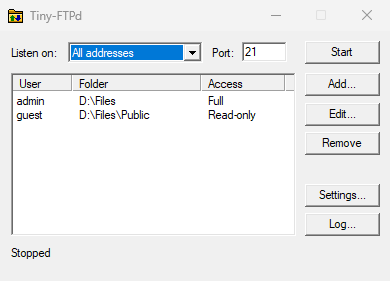

# Tiny-FTPd

Tiny-FTPd is an FTP server in a single binary. You add users, give each one a folder, and press Start.

```
220---------- Welcome to Tiny-FTPd ----------
220-Local time is now 00:58. Server port: 21.
220-This is a private system - No anonymous login
220 IPv6 connections are also welcome on this server.
```

- **Chroot-style jail per user.** No way out, even through `..` or symlinks.
- **Web access.** Browse, upload, and download from any browser.
- **FTPS.** Encrypted logins and transfers. Self-signed certificates and post-quantum key exchange built in.
- **Windows, macOS, and Linux.** A classic window on Windows, a CLI elsewhere. Nothing to install.

## Run it

Download the binary for your system from [Releases](../../releases/latest). To build it yourself, see [Build from source](#build-from-source).

### Windows



1. Download `tinyftpd-windows-amd64.exe`, or `tinyftpd-windows-arm64.exe` for an ARM PC.
2. Double-click it. The binary isn't signed, so SmartScreen may warn about it. Click **More info**, then **Run anyway**.
3. Click **Add...**, then enter a username, a password, and the folder to jail the user to.
4. Click **Start**. If Windows Firewall asks, allow access so other devices can connect.

The window shows the address to connect to. Click **Log...** to watch connections and transfers as they happen.

### macOS

1. Download `tinyftpd-darwin-arm64` for Apple silicon, or `tinyftpd-darwin-amd64` for Intel.
2. In Terminal, make it runnable, and remove the quarantine flag that macOS puts on downloads:

   ```sh
   cd ~/Downloads
   mv tinyftpd-darwin-arm64 tinyftpd
   chmod +x tinyftpd
   xattr -d com.apple.quarantine tinyftpd
   ```

3. Add a user. Tiny-FTPd asks for their password. The folder must already exist.

   ```sh
   ./tinyftpd user add alice ~/Public
   ```

4. Start the server. It prints the address to connect to.

   ```sh
   ./tinyftpd serve
   ```

### Linux

1. Download `tinyftpd-linux-amd64`, or `tinyftpd-linux-arm64` for ARM.
2. Make it runnable:

   ```sh
   mv tinyftpd-linux-amd64 tinyftpd
   chmod +x tinyftpd
   ```

3. Linux needs root for ports below 1024. To serve on port 21 without root, give the binary permission once. You can also set a higher `port` in the config instead.

   ```sh
   sudo setcap cap_net_bind_service=+ep ./tinyftpd
   ```

4. Add a user, then start the server. The folder must already exist.

   ```sh
   ./tinyftpd user add alice ~/share
   ./tinyftpd serve
   ```

### Connect

Use any FTP client, such as FileZilla, WinSCP, or `curl`. Windows' built-in `ftp.exe` won't work, because it supports only active mode.

## Commands

```sh
tinyftpd serve
tinyftpd user add [-readonly] [-bypass-limit] [-start folder] <name> <folder>
tinyftpd user rm <name>
tinyftpd user list
tinyftpd tls self-signed
```

`user add` updates the user if they already exist. To use another config file, put `-config <file>` before the command, for example `tinyftpd -config /etc/tinyftpd.json serve`.

## Settings

Tiny-FTPd keeps its settings in `tinyftpd.json`, next to the binary. User changes apply without a restart. The Windows app sets most keys in its Settings dialog.

| Key | Default | What it does |
|---|---|---|
| `listenIP` | all addresses | Address to listen on, such as a Tailscale IP |
| `port` | `21` | FTP port |
| `pasvMin`, `pasvMax` | OS picks | Range of passive data ports, for firewalls |
| `publicIP` | local address | Address sent to clients in `PASV` replies, for NAT |
| `maxConnections` | `50` | Users logged in at once. `0` means no limit |
| `web`, `webPort` | `false`, `8080` | Serve the web file browser on this port |
| `tls` | `false` | Require FTPS |
| `tlsCert`, `tlsKey` | | PEM certificate and private key |
| `tlsPostQuantum` | `false` | Refuse clients without post-quantum key exchange |

To turn on FTPS with a self-signed certificate, run `tinyftpd tls self-signed`, or click **Generate self-signed** in Settings. In your FTP client, choose explicit FTP over TLS, or use an `ftpes://` URL.

## Build from source

You need Go 1.26 or newer.

```sh
go build ./cmd/tinyftpd   # build for this machine
make                      # build every binary into dist/
make test                 # run the tests
```

## Licence

Tiny-FTPd is released under the [MIT licence](LICENSE).
